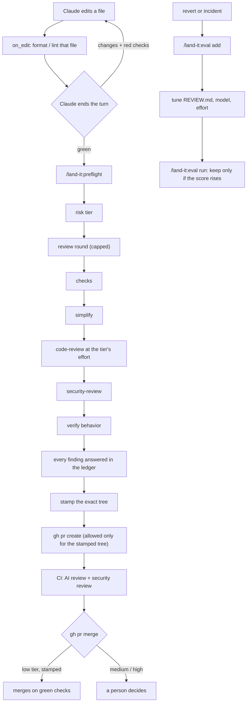

# land-it

**English** · [Русский](README.ru.md)


**You land it, you own it.** land-it is a Claude Code plugin that brings the code review process the Claude Code
team describes for itself into any repository. Machines do most of the reading, people spend attention where
the risk is, and no change reaches a pull request without evidence that it works.

## Based on the article

land-it is built on **[How the Claude Code team does code review](https://claude.dev/blog/solving-code-review-at-anthropic/)**
by Addy Osmani, Morgan Westlee Lunt and Qing Wang (claude.dev blog, October 15, 2026). Each feature here maps to a
practice from that article; the [mapping table](#from-the-article-to-land-it) lists them one by one.

The article in five points:

- **Minimize human review time without raising reverts or incidents.** The question isn't "did a human read the
  code?" but "what could go wrong, and which check, automated or human, should catch it?"
- **Verify before the PR.** Run tests, build and lint and *show the output*; review the diff in a fresh context;
  fix repeated findings at the source (a skill, a lint rule, CLAUDE.md, REVIEW.md).
- **AI review on every PR, every finding answered.** Findings are verified before they're posted, tagged
  Important / Nit / Pre-existing, and each one is fixed or resolved with a reason.
- **The change sets the risk tier, not the author.** Low-risk changes merge on green checks; risky ones get one or
  two people. An agent's approval never counts as a person's, and an approval covers one specific commit.
- **Make the reviewer better with evidence.** Past incidents become evals; a reviewer change is kept only if the
  score rises. Cap review rounds, re-review only the new diff, never repeat a finding.

> land-it is an independent open-source project by [FunFactoryDev](https://github.com/FunFactoryDev). It is not
> affiliated with, endorsed by, or supported by Anthropic. Claude and Claude Code are trademarks of Anthropic.

## Why a plugin

Claude Code already ships the reviewers: `/code-review`, `/security-review`, `/simplify`, `/verify`. What's missing
is everything around them, and that's what land-it adds:

- **Nothing makes them run.** They're commands you can forget. land-it's hooks make the checks run, and keep a
  PR from opening, without anyone remembering.
- **The local `/code-review` doesn't read `REVIEW.md`.** Only the managed Code Review service on GitHub does,
  and that service is for Team and Enterprise plans. land-it imports `REVIEW.md` from `CLAUDE.md`, so the local
  review follows the repo's rules too.
- **No evidence links the review to the PR.** land-it stamps the exact tree that passed checks and review;
  Claude can open a PR only for that tree.
- **A plugin is the only format that can enforce.** A skill or CLAUDE.md is advice the model may skip; hooks are
  deterministic. A plugin bundles hooks, skills and templates, installs per project in one command, and updates in
  one place.

## How it works



## From the article to land-it

| Practice from the article | land-it |
|---|---|
| Run tests, build and lint, and show the output instead of saying "done" | **Stop hook.** When Claude ends a turn that changed code, the checks run; on red, the failing output goes back to Claude instead of a "done". It catches changes made through Bash too |
| Formatter and linter hooks | **PostToolUse hook.** Per-file `on_edit` commands after every edit; a failure goes straight back to Claude |
| Review the diff in a fresh context; bug hunt, simplify, end-to-end check | **`/land-it:preflight`**: checks → `/simplify` → `/code-review` → `/security-review` → `/verify`, in that order |
| `REVIEW.md` written by code owners: what failure looks like, a nit cap, paths to skip, file:line evidence | **`/land-it:init`** writes one for the repo and imports it from CLAUDE.md |
| Every finding gets an answer; Pre-existing bugs aren't blamed on the author | **Findings ledger.** Each finding is fixed, won't fix (a reason is required) or pre-existing (from `git blame` against the base). The stamp refuses while any finding is open |
| The change sets the risk tier; a classifier, plus owner-listed sensitive paths and CI files | **Risk tiers** from paths: CI workflows, CODEOWNERS and land-it's own config are always high, docs are low. Claude may raise a tier from the content, never lower it |
| Quick / Standard / Deep review per repo | **`review_effort`**: `/code-review` effort per tier, default low / medium / high |
| Round cap, diff-only re-review, no repeated findings | **Review rounds.** From round 2 the review sees only the range since the previous round's snapshot; recorded findings aren't posted again; past `max_rounds` preflight stops and asks to rethink the approach |
| An approval covers one specific commit | **PreToolUse hook.** Claude's `gh pr create` is allowed only when HEAD's tree is exactly the stamped tree |
| An agent's approval never counts as a person's | Claude's `gh pr review --approve` is denied; `gh pr merge` asks you unless HEAD is stamped low-tier |
| PR template: Testing, Risk, How to revert | init installs it; preflight fills it from real command output |
| AI review and security review on every PR; all threads resolved; stale approvals dismissed | `init --ci --protect`: a GitHub workflow and branch protection, applied only after you confirm |
| Incidents become evals; a reviewer change is kept only if the score rises | **`/land-it:eval`**: the commit behind a revert becomes a case; `run` scores recall and noise and says keep or revert |

## Install

```
/plugin marketplace add FunFactoryDev/land-it
/plugin install land-it@land-it-marketplace --scope project
/land-it:init
/land-it:trust
```

- `--scope project` records the plugin in `.claude/settings.json`, so everyone who clones the repo gets it.
  The hooks stay silent in repositories without `.claude/land-it.json`, so a user-scope install is safe too.
- `/land-it:trust` approves the commands init wrote. Only you can run it; see [Trust](#trust).

Requirements: git, Python 3.9+ (stdlib only, nothing to install), a recent Claude Code (tested on 2.1.300).

## Daily use

1. **Work as usual.** After each edit, `on_edit` formats or lints the file. When Claude ends a turn that changed
   code, `stop_checks` run; red output goes back to Claude instead of a "done".
2. **Before the PR:** `/land-it:preflight` (add `commit` to let it commit the stamped tree).
3. **Open it:** `gh pr create --body-file <path preflight printed>`. If anything changed after the stamp, the hook says so.
4. **When something slips through** (a revert, an incident): `/land-it:eval add <the fix or revert>`. Before and
   after you edit REVIEW.md or switch models: `/land-it:eval run`.

## Commands

| Command | What it does |
|---|---|
| `/land-it:init` | Reads the project and writes `.claude/land-it.json` (checks, on-edit formatters, risk paths), a repo-specific `REVIEW.md`, the `@REVIEW.md` import in CLAUDE.md, and a PR template. Optionally a GitHub review + security workflow (`--ci`) and branch protection (`--protect`); both ask before touching GitHub |
| `/land-it:preflight` | The pre-PR pipeline: risk tier → review round → checks → simplify → code review → security review → behavior check → findings ledger → stamp → PR body |
| `/land-it:eval` | `add`: record the commit behind an incident as a case. `run`: review every case under today's rules, score recall and noise, compare with the last run. `list` |
| `/land-it:trust` | Approve the config's commands. Only a command you type counts; Claude can't invoke it |

### Review depth by tier

| Tier | Simplify | Code review | Security review | Behavior check | Human |
|---|---|---|---|---|---|
| low | skip | `review_effort.low` (low) | only for input parsing, auth, secrets | skip | none once checks are green |
| medium | yes | `review_effort.medium` (medium) | yes | if runtime behavior changes | one person reads the PR |
| high | yes | `review_effort.high` (high) | yes | yes | a person reads every high-tier file; `/code-review max` or `ultra` on request |

## Hooks

| Event | What land-it does |
|---|---|
| `UserPromptSubmit` | Snapshots the working tree, so each turn is judged on its own changes (your edits between turns aren't Claude's) |
| `PostToolUse` (Edit, Write) | Runs the matching `on_edit` commands on the edited file; a failure goes back to Claude |
| `Stop` | If the turn changed non-docs files: runs `stop_checks` (path-scoped ones only when touched). Red: blocks the stop with the output, at most 3 times per turn. A docs-only turn, or a stop on the same red tree Claude already saw, passes |
| `PreToolUse` (Bash) | `gh pr create` needs the stamp on HEAD's tree; `gh pr review --approve` is denied; `gh pr merge` asks you unless HEAD is stamped low; `land-it trust` from Claude's shell is denied |
| `UserPromptExpansion` | When *you* type `/land-it:trust`, records trust for the current commands |

## Configuration: `.claude/land-it.json`

```json
{
  "checks": {
    "lint": "npm run lint",
    "typecheck": "npx tsc --noEmit",
    "test-web": { "run": "pnpm -C web test", "paths": ["web/**"] },
    "test-api": { "run": "pnpm -C api test", "paths": ["api/**"] },
    "build": "npm run build"
  },
  "on_edit": { "*.{ts,tsx,js,jsx,css,json}": "npx prettier --write {file}" },
  "stop_checks": ["lint", "typecheck", "test-web", "test-api"],
  "risk": { "high": ["src/auth/**", "src/billing/**", "migrations/**"], "low": ["src/generated/**"] },
  "max_rounds": 3,
  "review_effort": { "low": "low", "medium": "medium", "high": "high" }
}
```

| Key | Meaning |
|---|---|
| `checks` | Ordered name → command, run from the repo root; stops at the first failure. A check can be `{"run", "paths"}` to run only when the change touches those paths |
| `on_edit` | Glob → command run after Claude edits a matching file; `{file}` is the shell-quoted path |
| `stop_checks` | Which checks the Stop hook runs (default: all). Leave slow suites out; preflight runs every check |
| `stop_gate` | `false` turns the Stop hook off |
| `risk` | `high` / `medium` / `low` globs. Unlisted paths are medium. Defaults: `*.md`, `docs/**`, `LICENSE*` low; `CLAUDE.md`, `REVIEW.md`, `.claude/**` medium; CI workflows, CODEOWNERS and this file always high |
| `max_rounds` | Review rounds before preflight stops and asks to rethink the approach (default 3) |
| `review_effort` | `/code-review` effort per tier. `max` is the deepest local pass, but it fans out to dozens of agents and can take most of an hour even on a small diff |
| `base` | The branch PRs target, if it isn't `origin/HEAD`, `main` or `master` |

Globs follow gitignore rules: `*` stays inside a path segment, `**` crosses segments, `{a,b}` alternates, a pattern
without `/` matches at any depth, and a directory pattern covers everything under it.

## Trust

The hooks run commands from `.claude/land-it.json`. Without a guard, editing that file would be a way to run
commands: in a mode that auto-accepts edits, Claude (say, misled by a prompt injection in the code it reads)
could write a new "check", and the Stop hook would run it without a Bash permission prompt.

So land-it works like direnv. A hash of `checks` and `on_edit` is pinned per repository in `~/.land-it/trust.json`.
Until you trust the current commands, nothing from the config runs: hooks tell you once, and `land-it check`
refuses. You trust them by **typing** `/land-it:trust`: the `UserPromptExpansion` hook fires only for commands a
person types, not for skills the model invokes, and the skill itself is marked user-only. From a terminal outside
Claude Code, `land-it trust` asks for a `y`. Any change to a command needs trust again; changes to other keys don't.

## Evals

A case is a past change with a confirmed bug (file, lines, a one-line summary) or a known-good change. Cases live in
`.land-it/evals/` and are committed, as the repo's memory of what the reviewer missed. `land-it eval run` checks out
each case in a throwaway worktree, copies in today's CLAUDE.md, REVIEW.md and land-it config, runs
`claude -p "/code-review <effort> <range>"` and scores it:

- **recall**: the share of recorded bugs the review cited within 5 lines of the recorded location;
- **noise**: findings per known-good case;
- **verdict** against the previous full run: keep a change only if recall rises, or holds with less noise.

`--only` iterates on one case without recording. `--reviewer "<cmd with {range}>"` scores another reviewer, such as
your own skill. `--model` and `--effort` compare models and depths.

## Cost in tokens and time

| Part | Cost |
|---|---|
| Always in context | About 300 tokens of skill descriptions, plus your REVIEW.md through CLAUDE.md (400–800 tokens). Cached across turns |
| Hooks | Local processes: 0 tokens while checks are green. On red, up to ~1k tokens of output per block, at most 3 per turn |
| `/land-it:preflight` | Mostly the reviews it runs, scaled by `review_effort` |
| `/land-it:eval run` | One review per case |

Measured in live runs:

| Run | API calls | Input tokens (from cache) | Output | Time |
|---|---|---|---|---|
| preflight, `/code-review max`, Sonnet, 6-line diff | 236 | ~18.3M (86%) | 67k | ~45 min |
| eval, 1 case, `/code-review low`, Haiku | 2 | ~97k | 1.4k | 21 s |
| hook smoke test, Haiku | 10 | ~630k | 3.8k | ~1 min |

The `max` run is why `max` is opt-in. To keep cost down: run preflight once per PR, not per commit; lower
`review_effort` for routine repos; iterate evals with `--only` on a small model. land-it also saves review spend:
re-review rounds see only the new diff, recorded findings aren't repeated, and nothing is reviewed on a red tree.

## CLI

The plugin puts `land-it` on Claude's PATH; the skills call it. You can call it too (`python3 <plugin>/bin/land-it …`).

| Command | Does |
|---|---|
| `land-it check` | Run the checks (path-scoped ones when the change touches them), print the output; on success mark the tree green |
| `land-it risk` | Tier of the change against the merge base, per file, plus the review effort per tier |
| `land-it round [--reset]` | Start a review round: number, cap, and the snapshot range for a diff-only re-review |
| `land-it findings [add \| resolve ID --status S --reason R]` | The branch's findings ledger; `add` takes JSON on stdin and tags pre-existing lines |
| `land-it stamp [--tier T]` | Bind the green tree and its tier; refuses on open findings or a tier below the path floor |
| `land-it status` | Trust, green and stamp state for the worktree and HEAD |
| `land-it trust` | Approve the config's commands, at your own terminal |
| `land-it eval [list \| add … \| run …]` | Reviewer evals |

## What lives where

| Path | Committed | What |
|---|---|---|
| `.claude/land-it.json` | yes | Checks, on-edit commands, risk paths, rounds, effort |
| `REVIEW.md`, `.github/pull_request_template.md` | yes | Review rules, PR template |
| `.land-it/evals/` | yes | Eval cases and `history.jsonl` |
| `.git/land-it/` | no | Per-worktree state: green tree, stamp, turn snapshots, per-branch rounds and findings |
| `~/.land-it/trust.json` | no | Your trust pins, per repository |

## Limitations

- The gates cover Claude's tool calls. You can still run `gh pr create` yourself; that's deliberate.
- Tested on macOS. Windows is untested: hooks call `python3`, and there's no state lock (no `fcntl`).
- `/security-review` needs `origin/HEAD`; without a remote, preflight runs the security pass in a fresh subagent.
- Eval recall counts any `file:line` the review cites near the recorded bug; noise counts every cited location.

## Development

```
python3 -m unittest discover tests     # stdlib only, throwaway git repos
claude plugin validate . --strict
```

This repo uses land-it on itself: see [.claude/land-it.json](.claude/land-it.json).
Changes are listed in [CHANGELOG.md](CHANGELOG.md).

## License

MIT © FunFactoryDev. More about Claude Code: the free course at [zero2claude.ru](https://zero2claude.ru) (in Russian).
