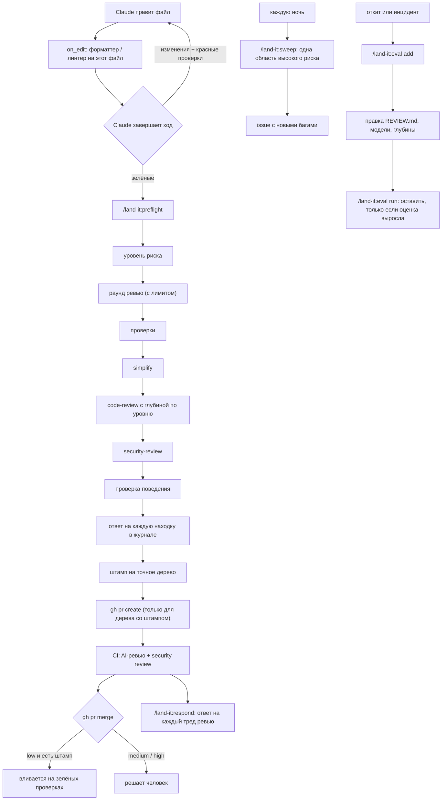

# land-it

[English](README.md) · **Русский**


**Влил — отвечаешь.** land-it — плагин для Claude Code, который переносит в любой репозиторий процесс ревью,
описанный командой Claude Code для самой себя. Большую часть чтения кода делают машины, люди тратят внимание
там, где есть риск, и ни одно изменение не попадает в pull request без доказательств, что оно работает.

## Основа: статья из блога

В основе land-it — статья **[How the Claude Code team does code review](https://claude.dev/blog/solving-code-review-at-anthropic/)**
(«Как команда Claude Code проводит ревью кода»). Авторы — Addy Osmani, Morgan Westlee Lunt и Qing Wang, блог claude.dev,
15 октября 2026 года. Каждая функция land-it соответствует практике из статьи; все они перечислены в
[таблице соответствия](#от-статьи-к-land-it).

Статья в пяти пунктах:

- **Минимум человеческого времени на ревью без роста откатов и инцидентов.** Вопрос не «прочитал ли код человек?»,
  а «что может сломаться и какая проверка, автоматическая или человеческая, должна это поймать?»
- **Проверка до PR.** Запустить тесты, сборку и линт и *показать вывод*; отревьюить diff в свежем контексте;
  повторяющиеся находки исправлять в источнике (скилл, правило линтера, CLAUDE.md, REVIEW.md).
- **AI-ревью каждого PR, ответ на каждую находку.** Находки проверяются перед публикацией и помечаются
  Important / Nit / Pre-existing; каждую либо исправляют, либо закрывают с объяснением.
- **Уровень риска задаёт изменение, а не автор.** Изменения с низким риском вливаются на зелёных проверках,
  рискованные смотрят один или два человека. Одобрение агента никогда не засчитывается за человеческое,
  а одобрение действует только для конкретного коммита.
- **Ревьюер улучшают на доказательствах.** Прошлые инциденты становятся evals; изменение ревьюера оставляют,
  только если оценка выросла. Раунды ревью ограничены, повторное ревью смотрит только новый diff, находки не повторяются.

> land-it — независимый проект с открытым кодом от [FunFactoryDev](https://github.com/FunFactoryDev). Он не связан
> с Anthropic, не одобрен и не поддерживается ею. Claude и Claude Code — товарные знаки Anthropic.

## Почему плагин

Ревьюеры в Claude Code уже есть: `/code-review`, `/security-review`, `/simplify`, `/verify`. Не хватает всего,
что вокруг них, и это добавляет land-it:

- **Их ничто не заставляет запускаться.** Это команды, о которых легко забыть. Хуки land-it запускают проверки
  и не дают открыть PR, и помнить об этом никому не нужно.
- **Локальный `/code-review` не читает `REVIEW.md`.** Его читает только управляемый сервис Code Review на GitHub,
  а он доступен на тарифах Team и Enterprise. land-it подключает `REVIEW.md` через `CLAUDE.md`, и локальное ревью
  тоже следует правилам репозитория.
- **Нет доказательства, что PR — это то, что прошло ревью.** land-it ставит штамп на конкретное дерево, прошедшее
  проверки и ревью; Claude может открыть PR только для этого дерева.
- **Только плагин может заставлять.** Скилл или CLAUDE.md — совет, который модель может пропустить; хуки
  детерминированы. Плагин объединяет хуки, скиллы и шаблоны, ставится в проект одной командой и обновляется в одном месте.

## Как это работает



## От статьи к land-it

| Практика из статьи | land-it |
|---|---|
| Запускать тесты, сборку и линт и показывать вывод, а не говорить «готово» | **Stop-хук.** Когда Claude завершает ход, в котором менялся код, запускаются проверки; на красных вывод ошибок уходит обратно Claude вместо «готово». Ловит и изменения через Bash |
| Хуки для форматтеров и линтеров | **PostToolUse-хук.** Команды `on_edit` для каждого файла после каждой правки; ошибка сразу уходит Claude |
| Ревью diff в свежем контексте; поиск багов, упрощение, сквозная проверка | **`/land-it:preflight`**: проверки → `/simplify` → `/code-review` → `/security-review` → `/verify`, именно в таком порядке |
| `REVIEW.md` от владельцев кода: как выглядит поломка, лимит мелочей, пути-исключения, доказательство `файл:строка` | **`/land-it:init`** пишет его под репозиторий и подключает из CLAUDE.md |
| На каждую находку в PR нужен ответ: исправить или закрыть тред с объяснением | **`/land-it:respond`**: открытые треды в PR (Code Review, CI-workflow, Copilot, люди) попадают в журнал, исправляются или получают обоснованный won't fix, а ответы и закрытие тредов публикуются после вашего подтверждения |
| Ответ на каждую находку; старые баги не вешают на автора | **Журнал находок.** Каждая находка: исправлена, won't fix или pre-existing; для двух последних нужна причина. `git blame` даёт подсказку (`introduced: before / this-change`), но не вердикт: старая строка может сломаться из-за нового кода. Штамп не ставится, пока есть открытые находки |
| Уровень риска задаёт изменение; классификатор плюс чувствительные пути от владельцев и файлы CI | **Уровни риска** по путям: workflow CI, CODEOWNERS и конфиг самого land-it — всегда high, документация — low. Claude может поднять уровень по содержанию, но не понизить |
| Quick / Standard / Deep для каждого репозитория | **`review_effort`**: глубина `/code-review` для каждого уровня, по умолчанию low / medium / high |
| Лимит раундов, повторное ревью только по diff, без повторов находок | **Раунды ревью.** Со второго раунда ревью видит только изменения со снимка прошлого раунда; записанные находки не повторяются; после `max_rounds` preflight останавливается и предлагает пересмотреть подход |
| Одобрение действует для конкретного коммита | **PreToolUse-хук.** `gh pr create` от Claude разрешён, только если дерево HEAD совпадает с деревом штампа |
| Одобрение агента не засчитывается за человеческое | `gh pr review --approve` от Claude запрещён; `gh pr merge` спрашивает вас, если HEAD не помечен как low |
| Шаблон PR: Testing, Risk, How to revert | init ставит шаблон, preflight заполняет его по реальному выводу команд |
| AI-ревью и security review на каждый PR, каждый новый коммит проверен; статус означает, что анализ завершился; все треды закрыты; устаревшие одобрения сбрасываются | **`init --ci`**: на каждый push новые коммиты ревьюит `/land-it:ci-review` в GitHub Actions, а `land-it ci-verdict` выставляет статус коммита `land-it/review` по тому, что записало ревью: `success` — только если этапы уровня завершены и нет открытых Important-находок, иначе `failure`, а если ревью не завершилось — `error`. Находки публикуются inline, без повторов. `--protect` делает статус обязательным (прочитать, объединить, подтвердить — без слепой замены правил) |
| Инциденты становятся evals; изменение ревьюера оставляют, только если оценка выросла | **`/land-it:eval`**: коммит, стоящий за откатом, становится тест-случаем; `run` считает recall и шум и говорит, оставить или откатить; `eval scan` находит ещё не записанные откаты |
| Ночные агенты ревью ищут старые баги в существующем коде | **`/land-it:sweep`** и ночной workflow: одна область из `risk.high` за ночь по очереди, новые баги — одним issue, уже заведённые пропускаются |
| Отслеживать человеческое время (одобрения на PR, медиана и p95; человеческие комментарии; ожидание), а откаты и инциденты — как ограничитель | **`/land-it:stats`**: доля PR, прошедших с первого раунда, среднее число раундов, исходы находок, доля откатов в базовой ветке; с `--github` — одобрения и человеческие комментарии на PR и часы до merge, без ботов |
| Открытый пробел статьи: пока нет circuit breaker, ужесточающего одобрение при росте откатов | **Circuit breaker**: пока доля откатов в базовой ветке выше порога, минимальный уровень риска каждого изменения поднимается на ступень |
| Измерять шум: сортировать комментарии по реакции, гонять ревьюер на заведомо чистых PR | `wontfix_pct` в stats; чистые случаи в evals; `--judge` оценивает сам дефект через LLM-судью, а не совпадение ссылки |

## Установка

```
/plugin marketplace add FunFactoryDev/land-it
/plugin install land-it@land-it-marketplace --scope project
/land-it:init
/land-it:trust
```

- `--scope project` записывает плагин в `.claude/settings.json`, и его получает каждый, кто клонирует репозиторий.
  В репозиториях без `.land-it/config.json` хуки молчат, так что установка на уровне пользователя тоже безопасна.
- `/land-it:trust` одобряет команды, которые записал init. Запустить её можете только вы; см. [Доверие](#доверие).

Требования: git, Python 3.9+ (только стандартная библиотека, ставить ничего не нужно), свежий Claude Code
(проверено на 2.1.300).

## Повседневная работа

1. **Работайте как обычно.** После каждой правки `on_edit` форматирует или линтит файл. Когда Claude завершает
   ход с изменениями кода, запускаются `stop_checks`; красный вывод уходит Claude вместо «готово».
2. **Перед PR:** `/land-it:preflight` (с аргументом `commit` — он сам закоммитит дерево со штампом).
3. **Откройте PR:** `gh pr create --body-file <путь, который вывел preflight>`. Если после штампа что-то поменялось, хук об этом скажет.
4. **Когда что-то проскочило** (откат, инцидент): `/land-it:eval add <исправление или откат>`. До и после правки
   REVIEW.md или смены модели: `/land-it:eval run`.
5. **В PR пришли комментарии ревью:** `/land-it:respond`.
6. **Время от времени:** `/land-it:stats` — становится ли ревью быстрее без роста откатов.

## Команды

| Команда | Что делает |
|---|---|
| `/land-it:init` | Читает проект и пишет `.land-it/config.json` (проверки, форматтеры на правку, пути по уровням риска), `REVIEW.md` под репозиторий, подключение `@REVIEW.md` в CLAUDE.md и шаблон PR. По желанию — workflow ревью и security для GitHub (`--ci`), ночной поиск багов (`--sweep`) и branch protection (`--protect`); перед изменениями на GitHub спрашивает |
| `/land-it:preflight` | Конвейер перед PR: уровень риска → раунд ревью → проверки → simplify → code review → security review → проверка поведения → журнал находок → штамп → тело PR |
| `/land-it:eval` | `add`: записать коммит, стоящий за инцидентом, как тест-случай. `run`: отревьюить все случаи по сегодняшним правилам, посчитать recall и шум, сравнить с прошлым прогоном. `list` |
| `/land-it:trust` | Одобрить команды из конфига. Засчитывается только команда, набранная вами; Claude вызвать её не может |
| `/land-it:ci-review` | Только для CI: ревьюер workflow для одного запушенного диапазона коммитов. Записывает находки и этапы; ничего не меняет и не публикует |
| `/land-it:respond` | Ответить на каждый открытый тред ревью в PR: журнал → исправление или won't fix → ответы и закрытие тредов после вашего подтверждения |
| `/land-it:sweep` | Отревьюить одну область существующего кода на старые баги (сегодняшнюю область высокого риска или указанный путь) и завести новые находки одним issue. `--ci` — для запуска по расписанию |
| `/land-it:stats` | Метрики статьи для этого репозитория, прочитанные относительно её цели: меньше человеческого времени без роста откатов. `--github` добавляет человеческое время на PR |

### Глубина ревью по уровням

| Уровень | Simplify | Code review | Security review | Проверка поведения | Человек |
|---|---|---|---|---|---|
| low | нет | `review_effort.low` (low) | только для парсинга ввода, авторизации, секретов | нет | не нужен, если проверки зелёные |
| medium | да | `review_effort.medium` (medium) | да | если меняется поведение | один человек читает PR |
| high | да | `review_effort.high` (high) | да | да | человек читает каждый файл уровня high; `/code-review max` или `ultra` по запросу |

## Что доказывает штамп, а что нет

| | |
|---|---|
| **Обеспечивает land-it** | Проверки прошли ровно на этом дереве, не изменив его, и последний их прогон на нём не упал. Этапы ревью для уровня риска записаны в этом раунде (low: code; medium: + security; high: + verify, который может быть `not_run` с причиной). На каждую находку есть ответ, с причиной, если она не исправлена. Уровень не ниже того, что требуют пути и circuit breaker, и базовая ветка известна. |
| **Держится на том, что агент следует скиллу** | Что записанный этап действительно выполнялся и что он нашёл. Запись локальная; содержание ревью land-it проверить не может. |
| **Обеспечивает GitHub, если настроить** | Что каждый запушенный коммит прошёл ревью (обязательный статус `land-it/review` из CI-workflow), что треды закрыты, кто может вливать. Хуки повторяют эти правила для команд Claude; соблюдаются они благодаря branch protection. |
| **Пока нет** | Защищённого от подделки receipt от сервера. Статус в CI, как и локальный штамп, считается по тому, что записал ревьюер. |

## Хуки

| Событие | Что делает land-it |
|---|---|
| `UserPromptSubmit` | Делает снимок рабочего дерева, чтобы каждый ход оценивался по его собственным изменениям (ваши правки между ходами — не правки Claude) |
| `PostToolUse` (Edit, Write) | Запускает подходящие команды `on_edit` для изменённого файла; ошибка уходит Claude |
| `Stop` | Если ход поменял не только документацию: запускает `stop_checks` (проверки с `paths` — только когда их пути затронуты). На красных блокирует завершение и показывает вывод, не больше 3 раз за ход. Ход только с документацией или остановка на том же красном дереве, которое Claude уже видел, проходят |
| `PreToolUse` (Bash) | `gh pr create` требует штамп на дереве HEAD; `gh pr review --approve` запрещён; `gh pr merge` спрашивает вас, если HEAD не помечен как low; `land-it trust` и `land-it ci-verdict` из оболочки Claude запрещены; `land-it threads reply` и `resolve` всегда спрашивают вас, потому что действуют от вашего имени. Все запреты проверяются раньше любых вопросов, поэтому составная команда не протащит запрет через подтверждение |
| `UserPromptExpansion` | Когда *вы* набираете `/land-it:trust`, записывает доверие к текущим командам |

## Настройка: `.land-it/config.json`

Один файл для любого агента. В репозиториях, настроенных версиями 0.1–0.8, он лежит в `.claude/land-it.json`: его по-прежнему читают, а `land-it config migrate` переносит (доверие сохраняется). Оба файла сразу — ошибка. Ключи и типы проверяются при загрузке: на опечатку в ключе приходит подсказка «did you mean», а `stop_checks` с несуществующей проверкой отклоняется — иначе и то и другое молча отключило бы гейт. `land-it config` проверяет конфиг, `land-it doctor` — всю настройку.

```json
{
  "checks": {
    "lint": "npm run lint",
    "typecheck": "npx tsc --noEmit",
    "test-web": { "run": "pnpm -C web test", "paths": ["web/**"] },
    "test-api": { "run": "pnpm -C api test", "paths": ["api/**"] },
    "build": "npm run build"
  },
  "on_edit": { "*.{ts,tsx,js,jsx,css,json}": "npx prettier --write {file}" },
  "stop_checks": ["lint", "typecheck", "test-web", "test-api"],
  "risk": { "high": ["src/auth/**", "src/billing/**", "migrations/**"], "low": ["src/generated/**"] },
  "max_rounds": 3,
  "review_effort": { "low": "low", "medium": "medium", "high": "high" }
}
```

| Ключ | Значение |
|---|---|
| `checks` | Упорядоченный список «имя → команда», запуск из корня репозитория, остановка на первой ошибке. Проверка может быть `{"run", "paths"}` — тогда она запускается, только если изменение затрагивает эти пути |
| `on_edit` | Glob → команда, которая запускается после того, как Claude поправил подходящий файл; `{file}` — путь к изменённому файлу, он передаётся через `$LAND_IT_FILE`, поэтому никакое имя файла не выполнится как код. Пишите его без кавычек |
| `stop_checks` | Какие проверки запускает Stop-хук (по умолчанию все). Медленные наборы лучше исключить; preflight запускает все |
| `stop_gate` | `false` выключает Stop-хук |
| `risk` | Glob-шаблоны для `high` / `medium` / `low`. Не перечисленные пути — medium. По умолчанию: `*.md`, `docs/**`, `LICENSE*` — low; `CLAUDE.md`, `REVIEW.md`, `.claude/**` — medium; workflow CI, CODEOWNERS и этот файл — всегда high |
| `max_rounds` | Сколько раундов ревью до того, как preflight остановится и предложит пересмотреть подход (по умолчанию 3) |
| `review_effort` | Глубина `/code-review` для каждого уровня. `max` — самый глубокий локальный проход, но он запускает десятки агентов и может идти почти час даже на маленьком diff |
| `base` | Ветка, в которую идут PR, если это не `origin/HEAD`, `main` или `master`. Без известной базы `risk` и `stamp` отказывают, а не угадывают |
| `required_stages` | Этапы ревью, которые штамп требует для каждого уровня. По умолчанию `{"low": ["code"], "medium": ["code", "security"], "high": ["code", "security", "verify"]}` |
| `circuit_breaker` | По умолчанию `{"revert_rate": 0.05, "days": 14, "min_commits": 20, "mode": "observe"}`: сообщает, когда доля откатов среди first-parent коммитов базовой ветки выше порога. С `"mode": "enforce"` минимальный уровень каждого изменения поднимается на ступень, пока он сработал. `false` выключает |

Glob-шаблоны работают как в gitignore: `*` не выходит за сегмент пути, `**` проходит через сегменты, `{a,b}` —
альтернатива, шаблон без `/` совпадает на любой глубине, шаблон каталога покрывает всё внутри.

## Доверие

Хуки запускают команды из `.land-it/config.json`. Без защиты правка этого файла стала бы способом выполнить
команду: в режиме, где правки принимаются автоматически, Claude (например, введённый в заблуждение prompt injection
в читаемом коде) мог бы записать новую «проверку», и Stop-хук выполнил бы её без запроса разрешения на Bash.

Поэтому land-it работает как direnv. Хэш `checks` и `on_edit` закрепляется для каждого репозитория в
`~/.land-it/trust.json`. Пока текущие команды не одобрены, из конфига ничего не запускается: хуки один раз сообщают
об этом, а `land-it check` отказывается работать. Одобрить можно, только **набрав** `/land-it:trust`: хук
`UserPromptExpansion` срабатывает лишь на команды, которые набрал человек, а не на скиллы, вызванные моделью, и сам
скилл помечен как доступный только пользователю. В терминале вне Claude Code `land-it trust` просит ввести `y`.
Любое изменение команд требует повторного одобрения; изменения других ключей — нет.

Что это защищает: правка конфига не превратится в выполнение команд без вас, и Claude не может одобрить собственные команды ни через `land-it trust`, ни через точку входа хуков (`land-it hook` не работает вне хуков Claude Code), ни через хранилище доверия. Чего это не защищает: агент, которому вы разрешили любые shell-команды, может всё, что может ваша учётная запись. И доверие к `npm test` не ручается за код, который эта команда запускает: проверки недоверенного PR — дело изолированного CI.

## Evals

Тест-случай — это прошлое изменение с подтверждённым багом (файл, строки, описание в одну строку) или заведомо
чистое изменение. Случаи хранятся в `.land-it/evals/` и коммитятся: это память репозитория о том, что пропустил
ревьюер. `land-it eval run` разворачивает каждый случай во временном worktree, копирует туда сегодняшние CLAUDE.md,
REVIEW.md и конфиг land-it, запускает `claude -p "/code-review <effort> <range>"` и оценивает результат:

- **recall** — доля записанных багов, которые ревью указало в пределах 5 строк от записанного места;
- **шум** — число находок на одно чистое изменение;
- **вердикт** относительно прошлого полного прогона: изменение оставляют, только если recall вырос, или не упал, а шума стало меньше.

`--judge haiku` заменяет поиск ссылки LLM-судьёй: он читает каждое ревью и решает, найден ли записанный дефект, даже если он описан иначе или указан в другом месте. Это стоит одного маленького дополнительного вызова на случай. Его согласие с оценкой человека не измерено, поэтому «оставить/откатить» — рекомендация; прогоны с разными способами оценки или изменённым набором случаев не сравниваются, а прогон, в котором случай упал, завершается с кодом 2. Сырой вывод ревьюера по каждому случаю сохраняется в `.git/land-it/eval-runs/`. `--only` позволяет итерироваться на одном случае без записи в историю. `--reviewer "<команда с {range}>"` оценивает
другой ревьюер, например ваш собственный скилл. `--model` и `--effort` сравнивают модели и глубину.

## Расход токенов и времени

| Часть | Расход |
|---|---|
| Всегда в контексте | Около 300 токенов описаний скиллов плюс ваш REVIEW.md через CLAUDE.md (400–800 токенов). Кэшируется между ходами |
| Хуки | Локальные процессы: 0 токенов, пока проверки зелёные. На красных — до ~1 тыс. токенов вывода за блок, не больше 3 блоков за ход |
| `/land-it:preflight` | В основном ревью, которые он запускает; зависит от `review_effort` |
| `/land-it:eval run` | Одно ревью на каждый случай |
| `/land-it:sweep` | Одно ревью одной области за запуск; ночной workflow запускает его раз в день |

Замеры живых прогонов:

| Прогон | Вызовов API | Входные токены (из кэша) | Выход | Время |
|---|---|---|---|---|
| preflight, `/code-review max`, Sonnet, diff в 6 строк | 236 | ~18,3 млн (86%) | 67 тыс. | ~45 мин |
| eval, 1 случай, `/code-review low`, Haiku | 2 | ~97 тыс. | 1,4 тыс. | 21 с |
| проверка хуков, Haiku | 10 | ~630 тыс. | 3,8 тыс. | ~1 мин |

Именно из-за прогона на `max` этот уровень включается только явно. Чтобы держать расход низким: запускайте
preflight один раз на PR, а не на каждый коммит; снижайте `review_effort` для рутинных репозиториев; итерируйтесь
по evals через `--only` на маленькой модели. land-it ещё и экономит на ревью: повторные раунды смотрят только новый
diff, записанные находки не повторяются, а на красном дереве ревью не запускается.

## CLI

Плагин кладёт `land-it` в PATH для Claude, скиллы вызывают его. Вызывать можно и вручную
(`python3 <путь к плагину>/bin/land-it …`).

| Команда | Что делает |
|---|---|
| `land-it check` | Запускает проверки (с `paths` — когда изменение их затрагивает), печатает вывод; при успехе помечает дерево зелёным |
| `land-it risk` | Уровень риска изменения относительно merge base, по файлам, плюс глубина ревью для каждого уровня |
| `land-it round [--reset]` | Начинает раунд ревью: номер, лимит и диапазон снимков для повторного ревью только по diff |
| `land-it findings [add \| resolve ID --status S --reason R]` | Журнал находок ветки; `add` принимает JSON на stdin и добавляет к каждой находке подсказку из blame |
| `land-it stage KIND --status S [--reason R]` | Записать, что этап ревью текущего раунда выполнен (`completed`) или почему нет (`skipped`, `not_run`) |
| `land-it stamp [--tier T]` | Привязывает зелёное дерево и его уровень; отказывает при открытых находках, незаписанных этапах ревью, неизвестной базе или уровне ниже минимального |
| `land-it status` | Доверие, «зелёность» и штамп для рабочего дерева и HEAD |
| `land-it trust` | Одобрить команды конфига — в вашем собственном терминале |
| `land-it config [migrate]` | Где конфиг и корректен ли он; `migrate` переносит `.claude/land-it.json` в `.land-it/config.json` |
| `land-it doctor` | Инструменты, репозиторий, конфиг, доверие, базовая ветка, глубина истории, правила ревью, установка в проект: по строке на пункт, с исправлением |
| `land-it eval [list \| scan \| add … \| run …]` | Evals для ревьюера; `scan` находит откаты, ещё не ставшие тест-случаями |
| `land-it threads [PR \| reply ID --body B [--resolve] \| resolve ID]` | Открытые треды ревью в PR (номер, #N или URL; боты отличаются от людей); ответить на тред, закрыть тред |
| `land-it sweep-target [--day N]` | Область для сегодняшнего sweep, по очереди из `risk.high` |
| `land-it ci-verdict --sha SHA [--pr N] [--dry-run]` | CI: выставить статус `land-it/review` коммиту по записанному ревью и опубликовать открытые находки (без повторов). Из оболочки Claude не запускается |
| `land-it stats [--days N] [--github]` | Прохождение с первого раунда, раунды, исходы находок, откаты, circuit breaker; человеческое время на GitHub |

## Что где лежит

| Путь | В git | Что |
|---|---|---|
| `.land-it/config.json` | да | Проверки, команды на правку, пути по уровням риска, раунды, глубина |
| `REVIEW.md`, `.github/pull_request_template.md` | да | Правила ревью, шаблон PR |
| `.land-it/evals/` | да | Тест-случаи и `history.jsonl` |
| `.git/land-it/` | нет | Состояние для каждого worktree: зелёное дерево, штамп, снимки ходов, раунды и находки по веткам |
| `.git/land-it/runs.jsonl` | нет | По строке на каждый штамп, общий для всех worktree; его читает `stats` |
| `~/.land-it/trust.json` | нет | Ваши одобрения, по репозиториям |

## Ограничения

- Гейты действуют на вызовы инструментов Claude. Вы сами по-прежнему можете выполнить `gh pr create` — это сделано намеренно.
- Bash-гейты сверяют текст команды (обычные формы `gh pr …`, включая `-R/--repo`), а не разбирают shell. Они повторяют branch protection и обязательные проверки GitHub — именно там место правилам, которые обязаны соблюдаться. Хук-политика при сбое блокирует: если он упал или не уложился во время, команда не выполнится.
- PR из форков в GitHub Actions не получают секретов и получают токен только на чтение, поэтому их CI-ревью заканчивается `error`.
- Codex: адаптер хуков (`land-it hook … --runtime codex`) уже есть и проверен на задокументированных payload Codex (правки через `apply_patch`, без `ask`, доверие — набрать `land-it trust`); сам пакет для Codex — в 1.0.
- Проверено на macOS. Windows не тестировался: хуки вызывают `python3`, и нет блокировки состояния (нет `fcntl`).
- `/security-review` нужен `origin/HEAD`; без удалённого репозитория preflight проводит security-проход в свежем субагенте.
- Recall в evals засчитывает любое `файл:строка`, которое ревью указало рядом с записанным багом; шум считает каждое указанное место.

## Разработка

```
python3 -m unittest discover tests     # только stdlib, временные git-репозитории
claude plugin validate . --strict
```

Этот репозиторий сам использует land-it: см.
[.land-it/config.json](.land-it/config.json). Изменения — в [CHANGELOG.md](CHANGELOG.md).

## Лицензия

MIT © FunFactoryDev. Больше о Claude Code — бесплатный курс на [zero2claude.ru](https://zero2claude.ru).
